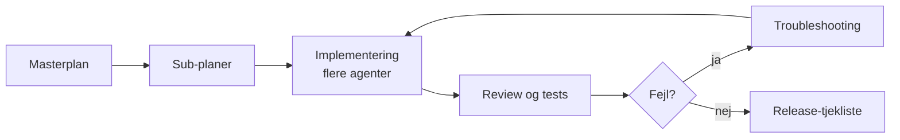

# AI-assisteret udvikling: repository-template

Genbrugelig struktur for repositories, hvor en sprogmodel (fx GitHub Copilot) planlægger, implementerer og fejlfinder kode sammen med mennesker.

Templaten består af markdown-filer med platzholdere i `{{KLAMMER}}`. Den indeholder ingen projektspecifikke detaljer.

## Brug

1. Opret et nyt repository ud fra denne template (**Use this template**).
2. Erstat `{{PROJEKTNAVN}}`, `{{FORMÅL}}` og øvrige platzholdere i `AGENTS.md`, `plans/` og `docs/`.
3. Slet eksempelfiler og afsnit, der ikke gælder for projektet.
4. Skriv en masterplan ud fra `plans/_masterplan-template.md`.
5. Opdel større områder i sub-planer ud fra `plans/_subplan-template.md`.

## Indhold

| Fil | Formål |
| --- | --- |
| `AGENTS.md` | Regler for sprogmodellen: sprog, kodestil, tilladte handlinger, datahåndtering. |
| `.github/copilot-instructions.md` | Kort pointer til `AGENTS.md`, som Copilot læser automatisk. |
| `docs/model-config.md` | Hvilken model og hvilket reasoning-niveau der bruges til hvilken opgave. |
| `plans/_masterplan-template.md` | Skabelon til hovedplanen. |
| `plans/_subplan-template.md` | Skabelon til sub-planer. |
| `docs/multi-agent.md` | Hvordan flere agenter kan implementere kode uden at træde hinanden over tæerne. |
| `docs/troubleshooting-template.md` | Skabelon til fejlfindingsnotater. |
| `docs/release-checklist.md` | Verifikation før merge, preview og produktion. |
| `docs/decisions/` | Beslutningslog (ADR-lignende). Skabelon i `docs/decisions/0000-skabelon.md`. |

## Arbejdsflow

## Vedligehold

Opdatér templaten, når en arbejdsgang har vist sig nyttig i flere projekter. Projektspecifikke regler hører hjem i det enkelte repository, ikke i templaten.
